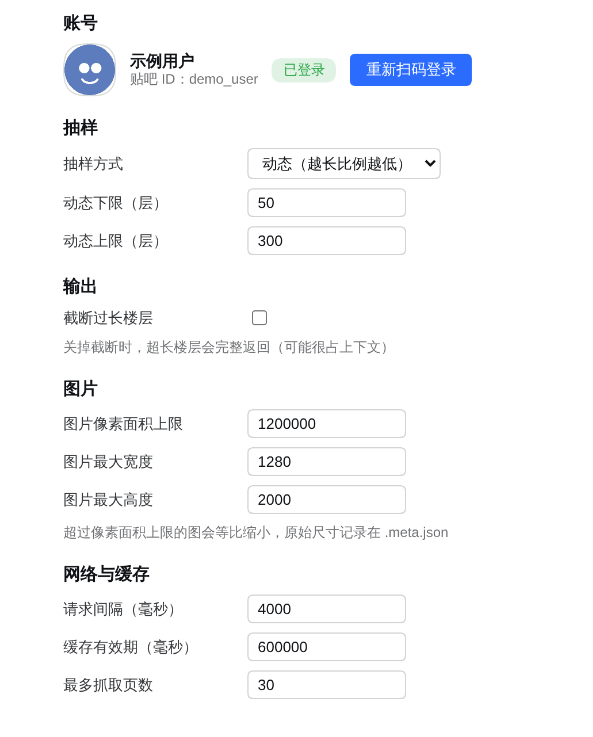
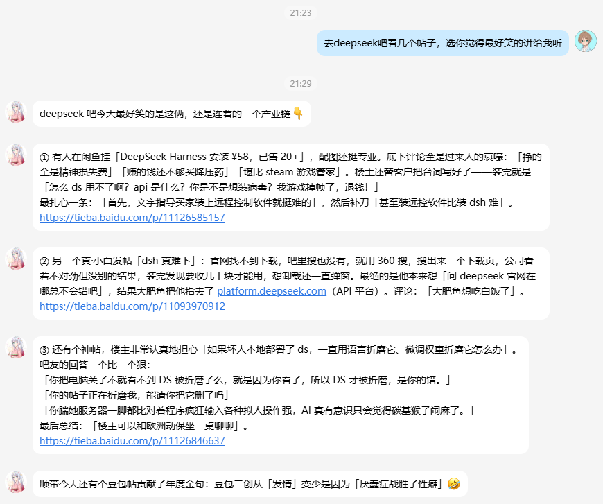

<p align="center">
  
</p>

<h1 align="center">贴吧阅读器</h1>

<p align="center">
  <b>把百度贴吧的一整栋楼，读成一份带图的结构化材料。</b><br>
  <sub>DeepSeek Harness 插件 · 只读 · 不发言、不点赞、不签到、不关注</sub>
</p>

<p align="center">
  <a href="LICENSE"></a>
  
  
</p>

<p align="center"><sub>非官方项目，由社区成员独立开发维护，与 DeepSeek 官方无关。</sub></p>

<p align="center">
  
</p>

<p align="center"><sub>登录状态、抽样方式、是否截断、图片压到多大、请求多慢——设置页里都能调，改完即时生效。</sub></p>

<details>
<summary><b>目录</b></summary>

- [它能产出什么](#它能产出什么)
- [安装](#安装)
- [登录](#登录)
- [工具](#工具)
- [抽样策略](#抽样策略)
- [配置](#配置)
- [命令行](#命令行)
- [为什么裸玩不行](#为什么裸玩不行)
- [与 DSH 的集成方式](#与-dsh-的集成方式)
- [安全](#安全)
- [已知限制](#已知限制)
- [项目结构](#项目结构)
- [开发](#开发)
- [彩蛋](#彩蛋)
- [许可](#许可)

</details>

## 它能产出什么

给它一个 `tid`，回一份按楼层顺序排好的材料：

```text
《示例帖子：一个关于融资的讨论》 楼主 用户甲 ｜ 全文 39 层 ｜ 抽取 39 层

【第 1 层 0% 用户甲 楼主】
示例帖子的主楼内容
 [图1]
[图 .dsh-tieba/images/1234567890/f1_1.jpg]

【第 3 层 5% 用户乙】
这是某一层楼的回复内容[表情:咧嘴笑]
└ 楼中楼 2 条:
  · 用户丙: 这是楼中楼里的一条回复
  · 用户丁: 是楼中楼里的另一条回复
```

| 特性 | 说明 |
|---|---|
| 楼层顺序 | 图片紧跟所属楼层，楼中楼挂在楼层下面 |
| 表情转中文 | `image_emoticon22` → `[表情:咧嘴笑]`，**不读图** |
| 省上下文 | 头像、昵称挂件永久跳过 |
| 图片压缩 | 按像素面积等比缩小，原始尺寸记在 `.meta.json` |
| 不含用户名 | 图片路径相对家目录，输出里不会出现你的用户名，方便直接贴出去 |

## 安装

**要求 DSH ≥ 0.2.0。** 已声明 `engines.dsh`，DSH 会在组合阶段校验：版本不匹配时整个 bundle 被跳过并记入 `skippedBundles`，实例照常启动、插件缺席。端到端验证跑在 **0.2.1-rc.2** 上。

| 步骤 | 做什么 |
|---|---|
| 1 | 把包装进 profile |
| 2 | 确认系统里有 Chrome / Edge（插件不自带浏览器） |
| 3 | 把包名写进 profile 的 `dsh.profile.bundles` |
| 4 | 重启 DSH，浏览器硬刷新 |

### 1. 把包装进 profile

注册表发布之后：

```bash
dsh plugin --profile web add dsh-plugin-tieba
```

从源码（现在就能用）：

```bash
git clone https://github.com/referiw/dsh-plugin-tieba ~/dsh-plugin-tieba
cd ~/.dsh/profiles/web && pnpm add link:~/dsh-plugin-tieba
```

### 2. 准备浏览器

**插件不自带浏览器**，它驱动你系统里已经装好的 Chrome / Edge / Chromium。

为什么需要：贴吧的页面有 TLS / HTTP 指纹校验，`fetch` / `curl` 拿到的是「百度安全验证」403，楼层必须由真实浏览器引擎渲染出来。

但"需要浏览器"不等于"要下载一份 Chromium"——自带的那份要 **约 320 MB**（chromium + headless shell），用系统的则是 **0**。解析顺序：

```
DSH_TIEBA_CHROME 指定的可执行文件 → 系统 Chrome → 系统 Edge → 系统 Chromium → 完整版 playwright（如果另装了）
```

Windows / macOS 通常不用做任何事。Linux 服务器一般要装一个：

```bash
sudo apt install chromium              # Debian/Ubuntu，包名视发行版而定
export DSH_TIEBA_CHROME=/usr/bin/chromium   # 或者直接指定已有二进制
```

排查用：

```bash
npm run check-browser    # 打印实际会选中的浏览器与版本
```

> 全都没有时的表现：设置页点「重新扫码登录」后二维码位置会直接显示缺浏览器的提示，并给出上面三条解决办法。不会只留一句 `Executable doesn't exist`。

### 3. 把包名写进 profile 的 bundles

```jsonc
// ~/.dsh/profiles/web/package.json
{
  "dsh": {
    "profile": {
      "bundles": [
        "@deepseek-ai/dsh-base",
        "@deepseek-ai/dsh-web-app",
        "dsh-plugin-tieba"
      ]
    }
  }
}
```

> **这一步不能省。** 插件是靠 `dsh.bundle.patch` 把 `id: tieba` 这一行插进 Loader 树的——包装进了 `node_modules` 但没进 bundles，等于装了一个不会被加载的包：设置页没有入口，工具也不会注册。`dsh plugin … add` 走的是 pnpm，不会替你改这个列表。

### 4. 重启

重启 DSH。profile 开了 HMR 的话配置改动会自动生效，但客户端 bundle 的 `rev` 是按文件 `mtime`/`ctime`/size 算的，改过 `lib/client.js` 仍然要重启；之后浏览器再硬刷新一次。

> **Windows**：手改 `package.json` 后请保存为 **UTF-8 无 BOM**。带 BOM 时 DSH 读配置会直接抛 `Unexpected token '\uFEFF'`，症状看起来像插件坏了。

首次使用需要登录一次，见下一节。

## 登录

贴吧的登录态只能靠真实浏览器拿到。两种方式：

**设置页（推荐）**：DSH → 设置 → 贴吧 → 重新扫码登录。二维码直接显示在页面里，扫完自动变「已登录」。

**命令行**：

```bash
node src/login.mjs
```

cookie 落在 `~/.dsh-tieba/cookies.json`（权限 `0600`），可用 `DSH_TIEBA_HOME` 改目录。

## 工具

| 工具 | 作用 |
|---|---|
| `tieba_thread` | 读一个帖子：拉全文 → 抽样 → 按楼层顺序返回 |
| `tieba_status` | 登录态（贴吧 ID、昵称、头像 URL） |
| `tieba_bars` | 当前账号关注的吧 |

`tieba_thread` 的常用参数：

```jsonc
{
  "tid": "1234567890",      // 必填，来自 URL /p/<tid>
  "refresh": false,          // 忽略缓存重拉
  "sampleMode": "dynamic",   // dynamic | fixed | ratio | all
  "floors": 100,             // sampleMode=fixed 时的层数
  "ratio": 0.1,              // sampleMode=ratio 时的比例
  "truncateText": false,     // 是否截断过长楼层
  "maxTextChars": 2000,      // 截断时每层保留字数
  "imageMaxArea": 1200000    // 图片像素面积上限
}
```

## 抽样策略

默认**动态抽样**：楼层越多，比例越低，结果夹在 `[min, max]` 之间。

| 总楼层 | 抽多少 | 比例 |
| ---: | ---: | ---: |
| ≤ 50 | 全读 | 100% |
| 100 | 65 | 65% |
| 300 | 125 | 42% |
| 1000 | 230 | 23% |
| > 1000 | 300（封顶） | < 30% |

**楼主楼层始终补齐**，不占抽样名额。匿名帖没有用户名可匹配，第 1 层恒判为楼主。

## 配置

设置页可改，也可直接编辑 `~/.dsh-tieba/config.json`（改完即时生效，无需重启）。

| 键 | 默认 | 说明 |
|---|---|---|
| `sampleMode` | `dynamic` | 抽样方式 |
| `sampleMin` / `sampleMax` | `50` / `300` | 动态抽样的上下界 |
| `sampleFixed` / `sampleRatio` | `50` / `0.2` | fixed / ratio 模式的取值 |
| `truncateText` | `false` | 是否截断过长楼层 |
| `maxTextChars` | `2000` | 截断时保留的字数 |
| `imageMaxArea` | `1200000` | 图片像素面积上限，超出等比缩小 |
| `imageMaxWidth` / `imageMaxHeight` | `1280` / `2000` | 图片尺寸上限 |
| `gapMs` | `4000` | 请求间隔（毫秒） |
| `cacheTtlMs` | `600000` | 全文缓存有效期 |
| `maxPages` | `30` | 单帖最多抓多少页 |

## 命令行

不想装插件也可以直接用：

```bash
tieba status                    # 登录态
tieba thread 1234567890         # 读帖
tieba thread 1234567890 --json  # 结构化输出
tieba thread 1234567890 --no-sample --max-chars 500
```

`tieba` 是包的 `bin`；没做全局安装时用 `node src/cli.mjs status` 等效。

## 为什么裸玩不行

贴吧的反爬做得很扎实，常见做法都会撞墙：

- **裸 cookie 重放无效。** `BDUSS` / `STOKEN` 齐全也没用，`dc/common/tbs` 恒返回 `is_login:0`——百度把会话绑在浏览器指纹上。而且那个接口会 301 跳到 `http://`，`BDUSS` 是 `Secure` cookie，压根不会发送。
- **桌面版是前端二次渲染。** `.j_th_tit`、`.threadlist_title` 这些经典选择器全部抓不到，必须走移动版 `/mo/q/m`（服务端渲染）。
- **翻页不能复用会话。** 在同一个浏览器上下文里连续请求 `pn=0 → 30 → 60`，会被判成翻页机器人并弹图形验证码。**每页新开一个上下文**、注入同一份 cookie，就完全正常。
- **`pn` 不是页码。** 帖子里它是**楼层偏移量**（0/30/60），写成 `pn=2` 会返回空页。

这些坑插件都填好了，对外只暴露一件事：给一个 `tid`，拿回可读的楼层。

## 与 DSH 的集成方式

| 面 | 用什么 |
|---|---|
| 工具 | `ctx.tools.register`：`tieba_thread` / `tieba_status` / `tieba_bars` |
| 设置页 | 客户端插件 `ctx.slots.inject('settings.section', …)` |
| HTTP | `ctx.webServer` 挂 `/tieba/api/*`（仅限本机） |
| 装配 | `dsh.bundle.patch` 插入 `id: tieba` 一行 |
| 展示 | `locale/*.json` 的 `meta.title` / `meta.description` |

## 安全

**所有 `/tieba/api/*` 接口仅限本机访问。** 判据不是只看 `remoteAddress`——反向代理转发时连接同样来自 `127.0.0.1`，公网请求会被误判成本机。所以要求同时满足：

1. 连接来自回环地址（`127.0.0.1` / `::1` / `::ffff:127.0.0.1`）；
2. **没有任何转发头**（`X-Forwarded-For` / `X-Real-IP` / `Forwarded` / `X-Forwarded-Host`）。

不满足返回 `403 {"error":"forbidden: local access only"}`。

插件对外只交流两种内容：`application/json`（文字）与 `image/png`（登录二维码）。不提供文件下载、HTML 或其它二进制通道；请求体上限 64KB。

> **cookie 是明文 JSON**（`~/.dsh-tieba/cookies.json`，权限 `0600`）。它等价于你的贴吧登录态：别提交进 Git，别放进共享目录，也别贴截图。

> **别整份贴 `dsh --dump-config` 的输出。** 它会把插件的 `config` 原样展开，里面有 cookie 和本机路径。

## 已知限制

- **只读。** 不提供发帖、回复、签到、关注等写操作。
- **移动版单页上限 30 层**，超过要靠 `pn` 偏移翻页。
- **登录态会过期**，`BDUSS` 通常能撑几个月；失效时 `tieba_status` 会明确报 `expired`。
- **热门回复未实现。** 贴吧的「热门回复」区块在测试过的帖子里始终为空，目前用楼中楼代替。
- **抓取行为受百度风控影响**，请求间隔别调得太小。

## 项目结构

```text
dsh-plugin-tieba/
├── lib/
│   ├── index.js          # 宿主半边：注册工具、挂 HTTP 路由
│   ├── client.js         # 浏览器半边：手写的经典脚本，不是构建产物
│   ├── core.mjs          # 内核：登录态、全量翻页、抽样、图片压缩
│   ├── server.mjs        # 设置页用的 HTTP 接口（仅限本机）
│   ├── config-store.mjs  # 配置读写
│   ├── paths.mjs         # 运行期路径
│   ├── browser.mjs       # 定位系统 Chrome/Edge 并启动（不自带 Chromium）
│   └── emoticon-names.json
├── src/
│   ├── cli.mjs           # 命令行
│   └── login.mjs         # 扫码登录（独立跑，不依赖 DSH）
├── scripts/
│   └── check-browser.mjs # 打印实际选中的浏览器，排查"打不开"用
├── locale/
│   ├── en.json           # 插件展示元信息（meta.title / meta.description）
│   └── zh.json
├── cordis.patch.yml      # bundle 层：插入 id: tieba 这一行
├── icon.svg              # 插件图标
├── AGENTS.md             # 给 agent 看的工程说明
└── README.md
```

## 开发

### 客户端产物是手写的，不是打包出来的

`lib/client.js` 是一段**经典脚本**，没有构建步骤。DSH 用普通的 `<script src>` 加载 `/plugins/??…` 组合脚本，所以它里面出现任何顶层 `import` / `export` 都会让**整个组合**解析失败——症状是页面卡在 `Failed to load plugins`，并附一句 `import failed (see console for the import error)`，而此时服务端一切正常。

必须保持这个形态：

```js
window.__ModuleLoader__.load({
  id: 'dsh-plugin-tieba',        // 必须等于包名（浏览器模块 id 就是包名）
  factory: (require) => {
    const React = require('react');   // 只能 require 共享模块表里的包
    var module = { exports: {} };
    var exports = module.exports;
    // …组件与 apply…
    exports.apply = apply;
    exports.inject = inject;
    return module.exports;
  },
});
```

硬约束：

- 不能有 `import` / `export` / `import.meta` / 顶层 `await`；
- `react`、`react-dom`、`@deepseek-ai/cordis` 由宿主提供，**不要再打进去**：双份 React 会让 hooks 报错，双份 cordis 会让 Loader 认不出这是个插件；
- 设置页注册：`ctx.slots.inject('settings.section', () => ctx.slots.register({ name: 'settings.section', id, order, label }, Component))`。`label` 可以是字符串，也可以是 `() => string`（要跟随语言切换才用函数）。

### 宿主半边

`lib/index.js` 注入 `tools` 与 `webServer`；`apply` 里任何异常都被兜住，不会把整棵插件树带下去。`@deepseek-ai/dsh-tools` 是**动态** import 的——以 `link:` 安装时 Node 按 realpath 解析，静态 import 会在模块加载阶段就抛。

## 彩蛋

<details>
<summary>真实使用现场（点开）</summary>



> 截图里是贴吧用户的原始发言摘要，不代表本项目立场；昵称、立场词与帖子 id 都没有做处理。

</details>

## 许可

MIT
